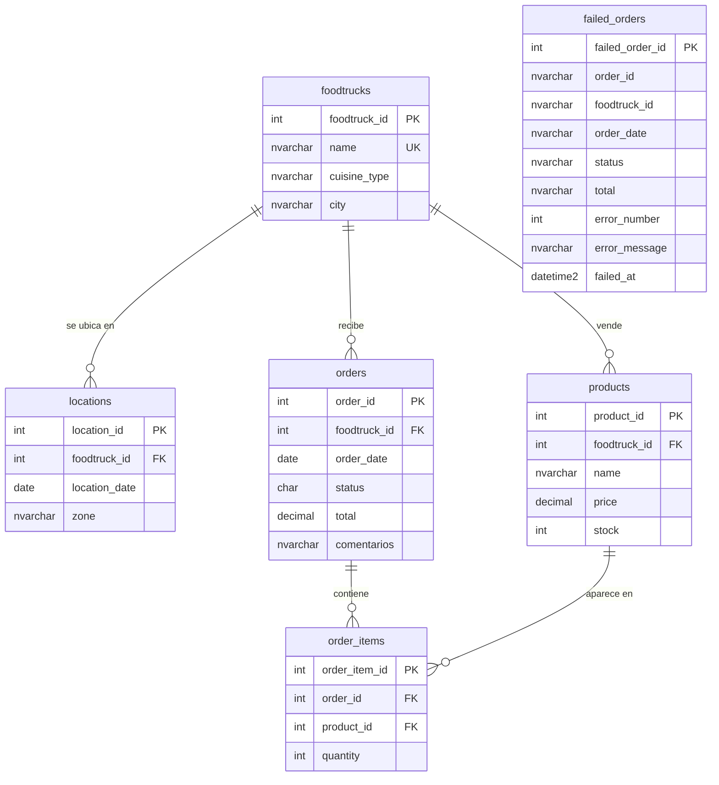

# FoodTrack DB

Esquema relacional inicial de **FoodTrack**, una plataforma para gestionar las operaciones de foodtrucks en distintos puntos de una ciudad. Está implementado en **Microsoft SQL Server** (corriendo en Docker), con **DBeaver** como cliente y versionado con **Git y GitHub**.

Proyecto de la homework del Módulo 2 (lecture *Introducción a las bases de datos y sublenguaje DDL*) de Henry.

## El caso

La base guarda:

- **Foodtrucks**: cada camión, su tipo de cocina y su ciudad.
- **Ubicaciones**: en qué zona está cada foodtruck cada día.
- **Productos**: lo que vende cada foodtruck, con precio y stock.
- **Pedidos**: las ventas, con fecha, estado y total.
- **Detalle de pedidos**: qué productos y cuántas unidades tiene cada pedido.

## Modelo de datos



`failed_orders` queda suelta a propósito: es la tabla auxiliar donde se registran los pedidos que `orders` rechazó, y no tiene claves foráneas (ver *Decisiones de diseño*).

### Restricciones

| Tabla | Restricciones |
|---|---|
| `foodtrucks` | PK `foodtruck_id`; `name` único |
| `locations` | PK `location_id`; único `(foodtruck_id, location_date)` (un foodtruck no está en dos zonas el mismo día); FK a `foodtrucks` |
| `products` | PK `product_id`; único `(foodtruck_id, name)`; `price >= 0`; `stock >= 0`; FK a `foodtrucks` |
| `orders` | PK `order_id`; `status` solo `P`, `R`, `E` o `C`; `total >= 0`; FK a `foodtrucks` |
| `order_items` | PK `order_item_id`; único `(order_id, product_id)` (un producto aparece una sola vez por pedido; las unidades van en `quantity`); `quantity > 0`; FK a `orders` y a `products` |
| `failed_orders` | PK `failed_order_id` (`IDENTITY`); `failed_at` con `DEFAULT SYSDATETIME()`; sin FK ni `CHECK`, a propósito |

### Códigos de `orders.status`

| Código | Significado |
|---|---|
| `P` | pendiente |
| `R` | en preparación |
| `E` | entregado |
| `C` | cancelado |

### Decisiones de diseño

- **IDs como `INT` manuales** (sin `IDENTITY`): los CSV traen sus propios IDs (por ejemplo, los pedidos empiezan en 1001) y así se pueden cargar sin cambios.
- **Dinero en `DECIMAL(10,2)`**, porque `FLOAT` redondea mal.
- **Texto en `NVARCHAR`**, para admitir acentos ("Ciudad de México").
- **`orders.total` es un dato redundante**: podría calcularse sumando precio × cantidad de `order_items`. Se mantiene como columna porque viene en los datos de origen.
- **Estado codificado**: `orders.csv` trae el texto completo (`entregado`, `pendiente`). Al cargar los datos se traduce a `E`/`P`, sin distinguir mayúsculas ni espacios de los costados. Un estado desconocido no se adivina: el pedido se rechaza y queda en `failed_orders`.
- **`failed_orders` guarda los datos como texto y sin restricciones**: tiene que aceptar justamente lo que `orders` rechazó (un foodtruck que no existe, una fecha inválida...). Es la única tabla con `IDENTITY`, porque cada intento fallido es un registro nuevo que no trae ID propio.
- **Scripts re-ejecutables**: cada script revisa antes si el objeto ya existe (`IF DB_ID(...)`, `IF OBJECT_ID(...)`, `IF COL_LENGTH(...)`). Se pueden correr varias veces, desde DBeaver o desde el notebook, sin que fallen por "ya existe". La carga de datos sigue la misma idea: cada `INSERT` va dentro de un `IF NOT EXISTS`.

## Estructura del repositorio

```
foodtrack-db/
├── README.md
├── .gitignore
├── foodtrack_homework.ipynb   ← notebook que ejecuta los scripts y carga los CSV
├── data/                      ← CSV de origen
│   ├── foodtrucks.csv
│   ├── locations.csv
│   ├── products.csv
│   ├── orders.csv
│   └── order_items.csv
└── scripts/                   ← scripts SQL (se ejecutan en este orden)
    ├── 00_create_database.sql
    ├── 01_create_tables.sql
    ├── 02_add_foreign_keys.sql
    ├── 03_alter_orders_add_comentarios.sql
    └── 04_create_failed_orders.sql
```

## Cómo ejecutarlo

### 1. Levantar SQL Server con Docker

```bash
docker run -d --name sql_server_container \
  -e ACCEPT_EULA=Y \
  -e MSSQL_SA_PASSWORD='<tu_contraseña>' \
  -p 1434:1433 \
  mcr.microsoft.com/mssql/server:2025-latest
```

La contraseña debe tener al menos 8 caracteres y combinar 3 de estos 4 tipos: mayúsculas, minúsculas, números y símbolos.

### 2. Conectarse

Datos de conexión (en DBeaver: nueva conexión → *SQL Server*):

| Campo | Valor |
|---|---|
| Host | `localhost` |
| Puerto | `1434` |
| Usuario | `sa` |
| Contraseña | la definida en el paso 1 |
| Trust Server Certificate | activado |

### 3. Ejecutar los scripts

**Opción A: DBeaver.** Abrí cada archivo de `scripts/` y ejecutalo completo (`Option + X`), en orden: `00`, `01`, `02`, `03`, `04`. El `00` se ejecuta conectado a `master`.

**Opción B: notebook.** Abrí `foodtrack_homework.ipynb` con Jupyter y ejecutá las celdas en orden. Necesita `pymssql`:

```bash
pip install pymssql pandas jupyter
```

El notebook busca las credenciales en un archivo `.env` una carpeta más arriba (`MSSQL_USER` y `MSSQL_SA_PASSWORD`). Si no lo encuentra, pide la contraseña por pantalla.

### 4. Cargar los datos

La carga de los CSV se hace desde el notebook (**paso 5**), con Python y `pymssql`: lee cada CSV con pandas y lo inserta fila por fila, en orden padre → hijo (`foodtrucks`, `locations`, `products`, `orders`, `order_items`), para que cada clave foránea encuentre su fila padre.

- **Se puede correr más de una vez**: cada `INSERT` va dentro de un `IF NOT EXISTS` que se fija si la clave primaria ya está. La segunda vez no duplica filas ni falla.
- **El estado se traduce al cargar**: `entregado` → `E`, `pendiente` → `P`.
- **Los pedidos rechazados quedan registrados**: cada pedido se inserta dentro de un `TRY...CATCH`. Si SQL Server lo rechaza, el `CATCH` lo guarda en `failed_orders` con el código y el mensaje del error. El notebook lo prueba con tres pedidos inválidos (un foodtruck que no existe, un total negativo y un estado desconocido).

No se usa `BULK INSERT` porque lee los archivos desde el disco del servidor, y SQL Server corre dentro de Docker: no ve las carpetas de tu Mac.

## Evolución del esquema

El script `03_alter_orders_add_comentarios.sql` agrega la columna opcional `comentarios` a `orders`, como ejemplo de un cambio estructural versionado en su propio commit.

## Extra credits

- **Carga de los CSV** con la traducción de `status`: paso 5 del notebook.
- **Registro de errores de inserción**: `scripts/04_create_failed_orders.sql` y la prueba al final del paso 5.
- **Diagrama ER**: el de la sección *Modelo de datos*.
